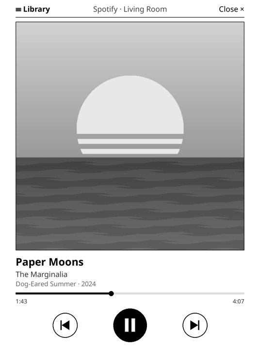
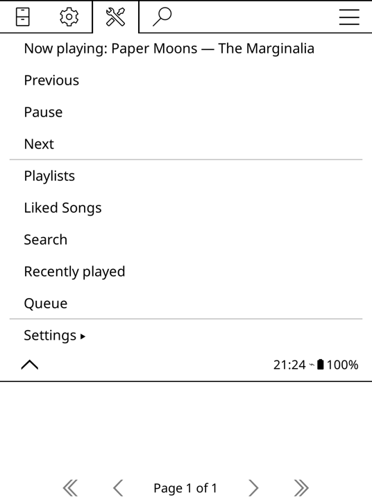
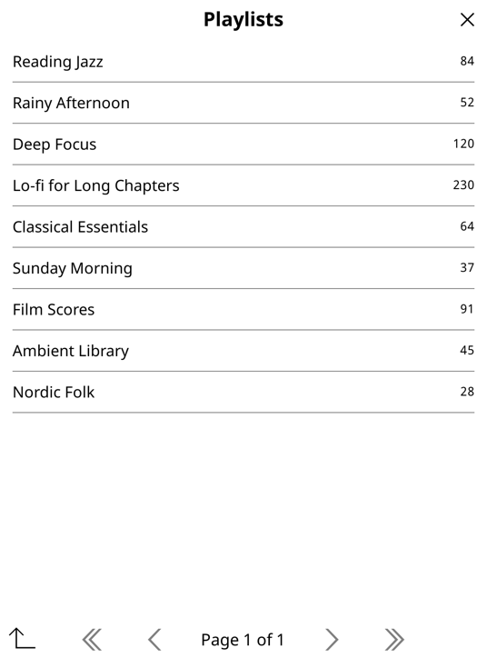

# KoPlay

**Spotify on your e-reader.** A [KOReader](https://github.com/koreader/koreader) plugin that shows what's playing on Spotify, lets you skip and pause without leaving your book, and browse your playlists from the e-ink screen.

[Türkçe](README.tr.md)

https://github.com/user-attachments/assets/9ffb7b35-4c38-42ac-983f-aa501ccaa0cf

<table>
  <tr>
    <td></td>
    <td></td>
    <td></td>
  </tr>
  <tr>
    <td align="center">Now playing</td>
    <td align="center">KoPlay menu</td>
    <td align="center">Library</td>
  </tr>
</table>

KoPlay is a remote control: the music plays on your phone, computer or speaker, and the e-reader shows it and controls it.

## Features

- **Now playing screen:** big album art, title, artist, album, progress, and previous / play-pause / next buttons. It's drawn for e-ink: one still frame per update, with a full refresh only when the track changes.
- **Controls while reading:** assign play/pause, next and previous to gestures. A short notification tells you what's playing, and your page stays where it is.
- **KoPlay menu:** the current track and the controls right in KOReader's tools menu.
- **Library:** your playlists, liked songs, search, recently played and the queue. Tap a track to play it, or long-press it to add it to the queue.
- **Device picker:** if no Spotify device is active, KoPlay lists your devices and asks where to play.
- **Languages:** follows KOReader's language. English and Turkish are included, and more are easy to add.

## Requirements

- An e-reader running KOReader. Tested on a Kindle Paperwhite 3 with KOReader v2026.07. Kobo and other devices should work too.
- **Spotify Premium.** Spotify only allows playback control for Premium accounts, and its developer apps require a Premium owner.
- A computer with Python 3, for a one-time login.
- Wi-Fi on the e-reader.

## Installation

### 1. Install the plugin

Download `koplay.koplugin.zip` from the [latest release](../../releases/latest) and unzip it. Copy the `koplay.koplugin` folder into `koreader/plugins/` on your e-reader, then restart KOReader.

### 2. Create a Spotify app (once)

KoPlay talks to Spotify through your own developer app, so nothing goes through a third-party server.

1. Go to the [Spotify developer dashboard](https://developer.spotify.com/dashboard) and click **Create app**.
2. Add `http://127.0.0.1:8888/callback` as the **Redirect URI**, exactly like this. Spotify rejects `localhost`.
3. Under **Which API/SDKs are you planning to use?**, tick **Web API**.
4. Save, then copy the **Client ID**.

### 3. Log in (once)

Download `koplay_auth.py` from the [latest release](../../releases/latest) (it's also in `tools/`) and run it on your computer:

```sh
python3 koplay_auth.py YOUR_CLIENT_ID
```

Your browser opens Spotify's consent page. Once you accept, the script writes `koplay.json` next to itself. Copy that file into `koreader/settings/` on your e-reader. On macOS, if a Kindle is connected over USB, the script offers to copy it for you.

> `koplay.json` gives access to your Spotify account, so don't share it. KoPlay keeps it on the device and only sends it to Spotify.

## Usage

- **KoPlay menu:** Tools (🔧) → **KoPlay**. From there you can:
  - see the current track (tap it to open the now playing screen)
  - use previous / pause / next
  - open your library lists
  - change the settings
- **Now playing screen:**
  - **☰ Library** opens your library.
  - **Close ×**, or swiping down, closes the screen.
- **Library:**
  - Tap a track to play it.
  - Long-press a track to choose between **Play** and **Add to queue**.
  - The arrow at the bottom left goes back.
- **Gestures while reading:** Settings → Taps and gestures → pick a gesture → General. These actions are available:

  | Action | What it does |
  |---|---|
  | KoPlay: play/pause | Plays or pauses without leaving the page |
  | KoPlay: next track / previous track | Skips |
  | KoPlay: show current track | Shows a short notification with the current track |
  | KoPlay: now playing / library | Opens that screen |

- **Settings:** the refresh interval (5–30 s while playing), and whether to keep the screen awake while the now playing screen is open.

## Good to know

- **Battery:** Wi-Fi stays on while the now playing screen is open. When playback is paused, KoPlay checks only every 30 s.
- **Spotify API limits** (since February 2026, for apps in development mode):
  - Search returns at most 10 results per type.
  - The tracks of other people's playlists can't be listed, but **▶ Play all** still plays the playlist.
  - At most 5 Spotify accounts can use one developer app.
- **"No active Spotify device":** Spotify forgets idle devices after a while. Open Spotify on your phone or computer, or pick a device when KoPlay asks.

## Adding a language

Strings live in [`koplay.koplugin/koplayl10n.lua`](koplay.koplugin/koplayl10n.lua). Add a table keyed by KOReader's language code (for example `de` or `fr`) and open a pull request.

## Development

`tools/emulator.sh` runs KoPlay in KOReader's macOS emulator at Paperwhite 3 resolution. Put `KOReader.app` from the [KOReader releases](https://github.com/koreader/koreader/releases) into `.emulator/` first. The plugin folder is symlinked, so restarting the emulator picks up your changes.

## Support

KoPlay is free and open source. If it makes your reading time better, you can support its development on [GitHub Sponsors](https://github.com/sponsors/orkunseyman).

## Disclaimer

KoPlay is an independent project. It is not affiliated with, endorsed by or sponsored by Spotify. Spotify is a trademark of Spotify AB.

## License

[AGPL-3.0](LICENSE), the same license as KOReader.
