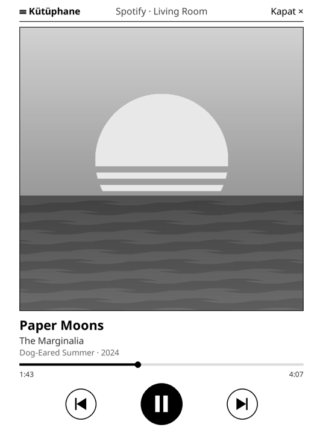
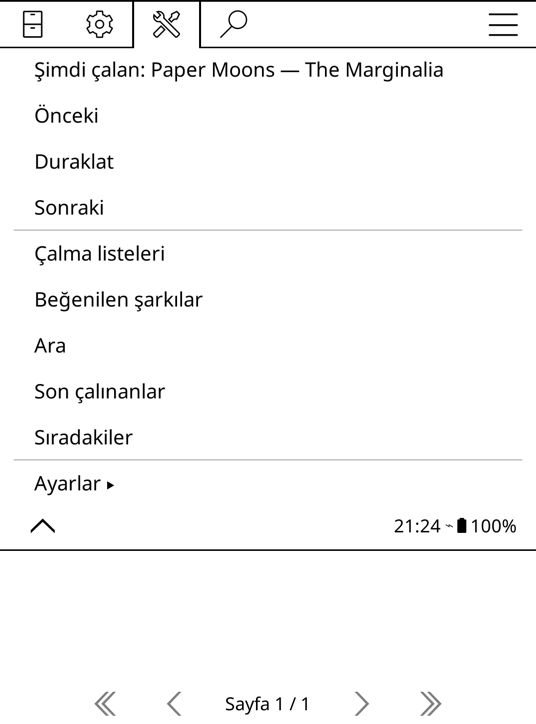
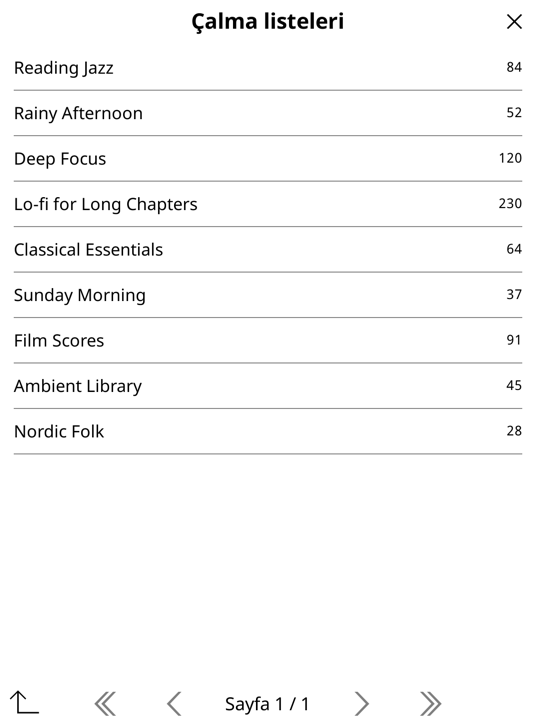

# KoPlay

**E-okuyucunda Spotify.** [KOReader](https://github.com/koreader/koreader) için bir eklenti. Spotify'da çalan şarkıyı gösterir, kitaptan çıkmadan şarkı geçmeni ve duraklatmanı sağlar, çalma listelerini e-ink ekrandan gezebilirsin.

[English](README.md)

https://github.com/user-attachments/assets/9ffb7b35-4c38-42ac-983f-aa501ccaa0cf

<table>
  <tr>
    <td></td>
    <td></td>
    <td></td>
  </tr>
  <tr>
    <td align="center">Şimdi çalan</td>
    <td align="center">KoPlay menüsü</td>
    <td align="center">Kütüphane</td>
  </tr>
</table>

KoPlay bir uzaktan kumandadır: müzik telefonunda, bilgisayarında ya da hoparlöründe çalar, e-okuyucu onu gösterir ve kontrol eder.

## Özellikler

- **Şimdi çalan ekranı:** büyük albüm kapağı, şarkı adı, sanatçı, albüm, ilerleme çubuğu, önceki / oynat-duraklat / sonraki tuşları. E-ink için tasarlandı: her güncelleme tek bir sabit kare, ekran sadece şarkı değişince tam yenilenir.
- **Okurken kontrol:** oynat/duraklat, sonraki ve önceki şarkıyı hareketlere ata. Kısa bir bildirim çalan şarkıyı gösterir, sayfan yerinden oynamaz.
- **KoPlay menüsü:** çalan şarkı ve kumanda tuşları doğrudan KOReader'ın araçlar menüsünde.
- **Kütüphane:** çalma listeleri, beğenilen şarkılar, arama, son çalınanlar ve sıradakiler. Bir şarkıya dokununca çalar, basılı tutunca sıraya eklenir.
- **Cihaz seçimi:** açık bir Spotify cihazı yoksa KoPlay cihazlarını listeler ve nerede çalınacağını sorar.
- **Dil:** KOReader'ın dilini kullanır. Türkçe ve İngilizce hazır, yeni dil eklemek kolay.

## Gereksinimler

- KOReader yüklü bir e-okuyucu. Kindle Paperwhite 3 ve KOReader v2026.07 ile test edildi. Kobo ve diğer cihazlarda da çalışması beklenir.
- **Spotify Premium.** Spotify çalma kontrolüne sadece Premium hesaplarda izin veriyor, geliştirici uygulamalarının sahibinin de Premium olması gerekiyor.
- Bir kerelik giriş için Python 3 yüklü bir bilgisayar.
- E-okuyucuda Wi-Fi.

## Kurulum

### 1. Eklentiyi yükle

[Son sürümden](../../releases/latest) `koplay.koplugin.zip` dosyasını indirip aç. `koplay.koplugin` klasörünü e-okuyucunda `koreader/plugins/` içine kopyala, sonra KOReader'ı yeniden başlat.

### 2. Spotify uygulaması oluştur (bir kez)

KoPlay, Spotify'a senin kendi geliştirici uygulaman üzerinden bağlanır, yani hiçbir şey başka birinin sunucusundan geçmez.

1. [Spotify geliştirici panelinde](https://developer.spotify.com/dashboard) **Create app**'e tıkla.
2. **Redirect URI** olarak tam şunu ekle: `http://127.0.0.1:8888/callback`. Spotify `localhost`'u kabul etmiyor.
3. **Which API/SDKs are you planning to use?** altında **Web API**'yi işaretle.
4. Kaydet ve **Client ID**'yi kopyala.

### 3. Giriş yap (bir kez)

[Son sürümden](../../releases/latest) `koplay_auth.py` dosyasını indir (`tools/` klasöründe de var) ve bilgisayarında çalıştır:

```sh
python3 koplay_auth.py CLIENT_ID
```

Tarayıcıda Spotify'ın izin sayfası açılır. Onaylayınca script, kendi yanına `koplay.json` dosyasını oluşturur. Bu dosyayı e-okuyucunda `koreader/settings/` klasörüne kopyala. macOS'ta Kindle USB ile bağlıysa script dosyayı senin için kopyalamayı teklif eder.

> `koplay.json` Spotify hesabına erişim sağlar, kimseyle paylaşma. KoPlay onu cihazda tutar ve sadece Spotify'a gönderir.

## Kullanım

- **KoPlay menüsü:** Araçlar (🔧) → **KoPlay**. Buradan şunları yapabilirsin:
  - çalan şarkıyı görmek (dokununca şimdi çalan ekranı açılır)
  - önceki / duraklat / sonraki
  - kütüphane listelerini açmak
  - ayarları değiştirmek
- **Şimdi çalan ekranı:**
  - **☰ Kütüphane** kütüphaneyi açar.
  - **Kapat ×** ya da aşağı kaydırmak ekranı kapatır.
- **Kütüphane:**
  - Bir şarkıya dokunmak onu çalar.
  - Bir şarkıya basılı tutunca **Çal** ve **Sıraya ekle** seçenekleri çıkar.
  - Sol alttaki ok geri götürür.
- **Okurken hareketler:** Ayarlar → Taps and gestures → bir hareket seç → General. Şu eylemler var:

  | Eylem | Ne yapar |
  |---|---|
  | KoPlay: oynat/duraklat | Sayfadan çıkmadan çalar ya da duraklatır |
  | KoPlay: sonraki şarkı / önceki şarkı | Şarkı değiştirir |
  | KoPlay: çalan şarkıyı göster | Kısa bir bildirimde çalan şarkıyı yazar |
  | KoPlay: şimdi çalan / kütüphane | İlgili ekranı açar |

- **Ayarlar:** yenileme aralığı (çalarken 5–30 sn) ve şimdi çalan ekranı açıkken ekranın uyanık tutulup tutulmayacağı.

## Bilmen gerekenler

- **Pil:** şimdi çalan ekranı açıkken Wi-Fi açık kalır. Çalma duraklatılmışken KoPlay sadece 30 saniyede bir kontrol eder.
- **Spotify API sınırları** (Şubat 2026'dan beri, geliştirme modundaki uygulamalar için):
  - Aramada her tür için en fazla 10 sonuç gelir.
  - Başkasının çalma listesindeki şarkılar listelenemez, ama **▶ Tümünü çal** listeyi yine de çalar.
  - Bir geliştirici uygulamasını en fazla 5 Spotify hesabı kullanabilir.
- **"Açık bir Spotify cihazı yok":** Spotify boşta kalan cihazları bir süre sonra unutur. Telefonda ya da bilgisayarda Spotify'ı aç ya da KoPlay sorduğunda bir cihaz seç.

## Yeni dil eklemek

Metinler [`koplay.koplugin/koplayl10n.lua`](koplay.koplugin/koplayl10n.lua) dosyasında duruyor. KOReader'ın dil koduyla (ör. `de`, `fr`) bir tablo ekleyip pull request açman yeterli.

## Geliştirme

`tools/emulator.sh` KoPlay'i KOReader'ın macOS emülatöründe Paperwhite 3 çözünürlüğünde çalıştırır. Önce [KOReader sürümlerinden](https://github.com/koreader/koreader/releases) indirdiğin `KOReader.app`'i `.emulator/` klasörüne koy. Eklenti klasörü sembolik bağlantıyla bağlı, emülatörü yeniden başlatınca değişikliklerin yüklenir.

## Destek ol

KoPlay ücretsiz ve açık kaynak. Okuma saatlerine bir şey kattıysa geliştirilmesini [GitHub Sponsors](https://github.com/sponsors/orkunseyman) üzerinden destekleyebilirsin.

## Not

KoPlay bağımsız bir projedir. Spotify ile bir bağlantısı yoktur, Spotify tarafından onaylanmamış ya da desteklenmemiştir. Spotify, Spotify AB'nin ticari markasıdır.

## Lisans

[AGPL-3.0](LICENSE), KOReader ile aynı lisans.
